<div align="center">


<p>
  <strong>An evidence-first, safety-gated electronics diagnostics &amp; repair intelligence platform</strong><br/>
  combining native OS telemetry, multimodal AI reasoning, hybrid technical-manual RAG, cross-device delta sync,<br/>
  and a physically isolated private observability console.
</p>

<p>
  <a href="#table-of-contents">Table of Contents</a> •
  <a href="#2-system-architecture--monorepo-topology">Architecture</a> •
  <a href="#4-ai-repair-copilot-hardware-decoders--hybrid-rag">AI Copilot &amp; RAG</a> •
  <a href="#5-validated-diagnostic-tool-registry-collectors--simulations">Diagnostics Engine</a> •
  <a href="#6-security-privacy-isolation--hardware-safety">Privacy &amp; Safety</a> •
  <a href="#9-complete-rest-api-reference">API Reference</a> •
  <a href="#10-getting-started--local-development">Quick Start</a> •
  <a href="#13-cicd-commercial-packaging--cloud-deployment">Deployment</a>
</p>

</div>

---

## Table of Contents

1. [What Is CoreSense? (Vision & Engineering Pillars)](#1-what-is-coresense)
2. [System Architecture & Monorepo Topology](#2-system-architecture--monorepo-topology)
3. [Applications & User Interfaces (Desktop, Mobile, Owner Console)](#3-applications--user-interfaces)
4. [AI Repair Copilot, Hardware Decoders & Hybrid RAG](#4-ai-repair-copilot-hardware-decoders--hybrid-rag)
5. [Validated Diagnostic Tool Registry, Collectors & Simulations](#5-validated-diagnostic-tool-registry-collectors--simulations)
6. [Security, Privacy Isolation & Hardware Safety](#6-security-privacy-isolation--hardware-safety)
7. [Dual-Database Schema Reference](#7-dual-database-schema-reference)
8. [Cross-Device Delta Synchronization Protocol](#8-cross-device-delta-synchronization-protocol)
9. [Complete REST API Reference](#9-complete-rest-api-reference)
10. [Getting Started & Local Development](#10-getting-started--local-development)
11. [Environment Configuration Reference](#11-environment-configuration-reference)
12. [Testing & 18-Scenario AI Diagnostic Evaluation Suite](#12-testing--18-scenario-ai-diagnostic-evaluation-suite)
13. [CI/CD, Commercial Packaging & Cloud Deployment](#13-cicd-commercial-packaging--cloud-deployment)
14. [Precision Instrument Design System](#14-precision-instrument-design-system)
15. [Additional Documentation](#15-additional-documentation)

<div align="center">
  
</div>

---

## 1. What Is CoreSense?

> ***"Understand what's happening beneath the surface."***

**CoreSense** is a full-stack commercial electronics diagnostics and repair intelligence platform designed for **every individual user** — from everyday laptop and phone owners trying to avoid an unnecessary \$600 motherboard replacement quote, to bench technicians inspecting USB-C Power Delivery rails, Windows WHEA bugchecks, SMART NVMe wear counters, and PCB silkscreen components.

Unlike generic chat wrappers that hallucinate fixes, fabricate `"92% confidence"` scores, or suggest destructive shell commands, CoreSense enforces **instrument-grade diagnostic discipline**:

| Pillar | What CoreSense Enforces |
| :--- | :--- |
| **Unified Technical Depth** | Every diagnostic response delivers plain-language clarity **alongside** complete technical evidence (exact error codes, SMART/rail telemetry, and concrete discriminating tests) up front without gating detail behind user roles. |
| **Honest Measurement Provenance** | Every single data point is cryptographically tagged with one of 5 strict provenance types: `measured`, `user_reported`, `inferred`, `unavailable`, or `simulated`. Synthetic test fixtures can **never** masquerade as real hardware telemetry. |
| **Evidence-Linked Hypotheses (Zero Fake %)** | CoreSense **never** prints invented confidence percentages. Every hypothesis lists `whyPossible`, `supportingEvidence`, `conflictingEvidence`, a `discriminatingTest`, `strengthenCriteria`, `weakenCriteria`, and evolves across 5 states (`active`, `strengthened`, `weakened`, `confirmed`, `ruled_out`). |
| **Zero Arbitrary Shell Execution** | AI models can **never** emit or run arbitrary bash/PowerShell/CMD commands. Only **9 predefined, Zod-validated tools** in `@coresense/shared` exist, and state-modifying tools (`flush_dns_cache`) require explicit per-action user approval. |
| **Physical Dual-Database Privacy Isolation** | Customer data (`coresense_customer.db`) and product telemetry (`coresense_owner.db`) live in physically separate databases with separate JWT secrets. The Owner Console API **never imports or receives a reference** to the customer database. |
| **Mandatory Hardware Safety Gate** | Swollen/punctured lithium batteries, high-voltage PSU/mains capacitors, fuse bypassing, and live liquid-damaged electronics trigger an immediate deterministic `critical_stop` / `high_risk` intervention that blocks dangerous DIY steps. |
| **Before-vs-After Resolution Proof** | CoreSense refuses to mark a fault resolved merely because a troubleshooting step was attempted. Formal verification compares baseline vs. fresh follow-up diagnostics across **5 strict outcomes**. |
| **Works 100% Offline Out-of-the-Box** | Runs on its built-in **CoreSense Local Diagnostic Engine** with zero external API keys required, and seamlessly upgrades to **Google Gemini 4 Interactions API**, **OpenAI**, or local **Ollama** (server-wide or AES-256-GCM encrypted user BYOK). |

<div align="center">
  
</div>

---

## 2. System Architecture & Monorepo Topology

CoreSense is engineered as a **TypeScript + Rust monorepo** powering **three genuinely connected, cleanly bounded applications** backed by a unified Fastify v5 API with hard physical privacy isolation.

### Colorful Full-Stack System Topology

```mermaid
flowchart TB
    subgraph CLIENTS["CLIENT APPLICATIONS LAYER"]
        direction LR
        DESK["CoreSense Desktop<br/>Tauri v2 · Rust sysinfo · React 19<br/>Tailwind v4 · Recharts · Port :5173"]
        MOB["CoreSense Mobile<br/>Capacitor 7 · iOS / Android / PWA<br/>Phone Checks · Camera · Voice · Port :8081"]
        OWN_UI["Private Owner Console<br/>Standalone React 19 · Recharts<br/>TOTP MFA · Telemetry · Port :5175"]
    end

    subgraph API["CORESENSE UNIFIED BACKEND API — FASTIFY v5 · NODE 24 · PORT :4000"]
        direction LR
        subgraph CUST_PLANE["Customer Workspace Plane  (/api/v1/*)"]
            C_AUTH["Customer Auth Guard<br/>HS256 JWT (JWT_SECRET)<br/>scrypt · AES-256-GCM BYOK"]
            COPILOT["AI Repair Copilot & Safety Gate<br/>Evidence Graph · Hardware Decoders<br/>5-State Resolution Verifier"]
            RAG["Hybrid Manuals RAG<br/>PDF/MD Chunker · FTS5 BM25 (45%)<br/>Gemini Embedding-2 (55%) · Anti-Injection"]
            DIAG["Validated Tool Dispatcher<br/>9 Registered Tools · Zod Strict<br/>Host CIM/POSIX + 11 Sim Fixtures"]
            SYNC["Delta Sync Engine<br/>Monotonic sync_log · Optimistic<br/>baseRevision Conflict Guard"]
        end

        SCRUB["PRIVACY ALLOWLIST SCRUBBER<br/>17 Allowed Events · 23 Blocked Keys<br/>HMAC-SHA256 Hash · PII Regex Redact"]

        subgraph OWN_PLANE["Owner Observability Plane  (/owner-api/v1/*)"]
            O_AUTH["Owner Auth Guard<br/>Separate OWNER_JWT_SECRET<br/>RFC 6238 TOTP MFA (6-digit 30s)"]
            O_METRICS["Aggregate Observability Engine<br/>Downloads vs Activations · DAU/WAU/MAU<br/>AI Cost Ledger · Crashes · Alert Rules"]
        end
    end

    subgraph AI_PROVIDERS["MULTI-PROVIDER AI RUNTIME (CONSENT-GATED)"]
        direction LR
        GEMINI["Google Gemini 4<br/>@google/genai Interactions API<br/>gemini-4-hydrogen / neon + embedding-2"]
        OAI["OpenAI / Ollama<br/>Chat Completions Vision<br/>Encrypted User BYOK or Server Key"]
        LOCAL["CoreSense Local Engine<br/>Deterministic Offline Fallback<br/>BSOD · PCB · USB-PD · Snapshot Rules"]
    end

    subgraph STORAGE["PHYSICALLY ISOLATED DUAL-DATABASE STORAGE (WAL MODE)"]
        direction LR
        CUST_DB[("coresense_customer.db<br/>15 Tables + FTS5 Virtual Table<br/>Users · Devices · Chats · Manuals<br/>Photos · Cases · Expenses · Sync")]
        OWN_DB[("coresense_owner.db<br/>14 Aggregate Telemetry Tables<br/>Downloads · Activations · Events<br/>AI Ledger · API Metrics · Crashes")]
    end

    DESK -->|"HTTPS / Customer JWT"| C_AUTH
    MOB -->|"HTTPS / Customer JWT"| C_AUTH
    OWN_UI -->|"HTTPS / Owner JWT + TOTP"| O_AUTH

    C_AUTH --> COPILOT
    C_AUTH --> RAG
    C_AUTH --> DIAG
    C_AUTH --> SYNC

    COPILOT -->|"Provider Router"| GEMINI
    COPILOT -->|"Provider Router"| OAI
    COPILOT -->|"Offline / Fallback"| LOCAL
    RAG -.->|"Optional Vector Embed"| GEMINI

    COPILOT --> CUST_DB
    RAG --> CUST_DB
    DIAG --> CUST_DB
    SYNC --> CUST_DB

    CUST_PLANE -.->|"Scrubbed Metadata Only"| SCRUB
    SCRUB -->|"Zero PII / Zero Prompts"| OWN_DB

    O_AUTH --> O_METRICS
    O_METRICS -->|"Read/Write Owner DB Only"| OWN_DB

    classDef desktop fill:#1e3a8a,stroke:#60a5fa,stroke-width:2px,color:#ffffff
    classDef mobile fill:#155e75,stroke:#22d3ee,stroke-width:2px,color:#ffffff
    classDef ownerUi fill:#065f46,stroke:#34d399,stroke-width:2px,color:#ffffff
    classDef custMod fill:#1e293b,stroke:#7ba7f7,stroke-width:1.8px,color:#f8fafc
    classDef scrubber fill:#9f1239,stroke:#fb7185,stroke-width:2.5px,color:#ffffff
    classDef ownerMod fill:#14532d,stroke:#4ade80,stroke-width:1.8px,color:#f0fdf4
    classDef aiCloud fill:#4c1d95,stroke:#a78bfa,stroke-width:2px,color:#ffffff
    classDef aiLocal fill:#92400e,stroke:#fbbf24,stroke-width:2px,color:#ffffff
    classDef custDb fill:#1d4ed8,stroke:#93c5fd,stroke-width:2.5px,color:#ffffff
    classDef ownDb fill:#047857,stroke:#6ee7b7,stroke-width:2.5px,color:#ffffff

    class DESK desktop
    class MOB mobile
    class OWN_UI ownerUi
    class C_AUTH,COPILOT,RAG,DIAG,SYNC custMod
    class SCRUB scrubber
    class O_AUTH,O_METRICS ownerMod
    class GEMINI,OAI aiCloud
    class LOCAL aiLocal
    class CUST_DB custDb
    class OWN_DB ownDb

    style CLIENTS fill:#0f172a,stroke:#475569,stroke-width:1.5px,color:#e2e8f0
    style API fill:#0b1120,stroke:#334155,stroke-width:1.5px,color:#e2e8f0
    style CUST_PLANE fill:#0c1a33,stroke:#3b82f6,stroke-width:1.5px,color:#bfdbfe
    style OWN_PLANE fill:#062119,stroke:#10b981,stroke-width:1.5px,color:#a7f3d0
    style AI_PROVIDERS fill:#170f2e,stroke:#8b5cf6,stroke-width:1.5px,color:#ddd6fe
    style STORAGE fill:#090d16,stroke:#64748b,stroke-width:1.5px,color:#e2e8f0
```

### Monorepo Workspace Matrix

| Workspace | Package Name | Purpose & Responsibilities | Primary Stack | Default Port |
| :--- | :--- | :--- | :--- | :--- |
| [`packages/shared`](packages/shared) | `@coresense/shared` | Shared Zod domain schemas, 9-tool Diagnostic Registry, 4-rule Hardware Safety Classifier, Prompt-Injection Sanitizer, Telemetry Allowlist Scrubber, BSOD/PCB/USB-PD Hardware Reference Engine | TypeScript 5.8 · Zod 3.24 | Library |
| [`packages/diagnostics-core`](packages/diagnostics-core) | `@coresense/diagnostics-core` | Read-only cross-platform OS collectors (CPU, RAM, Storage/SMART, Network/DNS/Wi-Fi, OS Event Logs, Battery/Displays), approval-gated DNS flush, and 11 explicitly labeled deterministic simulation fixtures | TypeScript · Windows CIM/WMI · POSIX · Node OS/DNS/Net | Library |
| [`apps/api`](apps/api) | `@coresense/api` | Unified Fastify v5 API with dual isolated Node 24 SQLite databases (`coresense_customer.db` & `coresense_owner.db`), AI Copilot Router, FTS5+Vector RAG, Image Clarity Inspector, Delta Sync, Crypto & TOTP MFA | Fastify 5 · Node 24 `node:sqlite` · `@google/genai` 3.2 · `pdf-parse` | `http://127.0.0.1:4000` |
| [`apps/desktop`](apps/desktop) | `@coresense/desktop` | Commercial installable native desktop workbench with Rust `sysinfo` diagnostic commands, AI Copilot, Live Diagnostics, Device Library, Manuals, Repair Cases, Offline Cache & Delta Sync | Tauri v2 · Rust (`sysinfo 0.33`) · React 19 · Tailwind v4 · Recharts | `http://127.0.0.1:5173` |
| [`apps/mobile`](apps/mobile) | `@coresense/mobile` | Portable repair companion for iOS, Android & installable Mobile PWA — Permitted Phone Checks (Battery, Network, Speaker, Mic, Display, 16-Tile Touch, Camera, Motion), Board Photo Capture, Voice Copilot & Sync | Capacitor 7 · React 19 · Tailwind v4 · Service Worker PWA | `http://127.0.0.1:8081` |
| [`apps/owner-console`](apps/owner-console) | `@coresense/owner-console` | Completely standalone Private Owner Observability Console — Downloads vs Activations, DAU/WAU/MAU, Retention, Funnel, AI Cost Ledger, Reliability, Crashes, Feedback, Alert Thresholds & TOTP MFA | Standalone React 19 · Tailwind v4 · Recharts | `http://127.0.0.1:5175` |
| [`tests`](tests) | Vitest Suite | 18-Scenario AI Diagnostic & Safety Evaluation Suite (`ai-eval.test.ts`) + End-to-End Platform, Security, Sync & Privacy Boundary Audit (`coresense.e2e.test.ts`) | Vitest 3 · In-Memory Dual SQLite | CLI (`npm test`) |

<details>
<summary><strong>Click to expand Complete Annotated Monorepo Directory Tree</strong></summary>

```text
CoreSense/
├── .github/workflows/
│   └── ci-release.yml                 # CI build/test + tag-triggered Win/macOS/Linux Tauri installer matrix
├── docs/assets/
│   ├── coresense-hero.svg             # Animated OLED precision oscilloscope hero banner
│   ├── copilot-live-loop.svg          # Animated closed-loop AI diagnostic pipeline graphic
│   ├── privacy-boundary-live.svg      # Animated dual-database privacy firewall visual
│   └── diagnostic-pulse-divider.svg   # Animated oscilloscope signal section divider
├── packages/
│   ├── shared/src/
│   │   ├── types.ts                   # Provenance, Evidence, Hypothesis, Verification, Device, Case & Sync Zod schemas
│   │   ├── tools.ts                   # 9-tool Diagnostic Registry + strict ToolParametersSchema
│   │   ├── safety.ts                  # Hardware safety hazard classifier + untrusted document prompt-injection sanitizer
│   │   ├── telemetry.ts               # 17 allowed events, 23 forbidden keys, regex PII/credential/path scrubber
│   │   ├── hardwareRef.ts             # 7 BSOD/Event ID decoders + 7 PCB silkscreen designators (U/Q/C/L/F/D/R)
│   │   └── index.ts                   # Barrel exports
│   └── diagnostics-core/src/
│       ├── collectors.ts              # Cross-platform OS collectors (Windows CIM/WMI + POSIX + TCP/DNS) & dispatcher
│       ├── simulations.ts             # 11 strictly labeled `measurementType: 'simulated'` deterministic test fixtures
│       └── index.ts                   # Barrel exports
├── apps/
│   ├── api/
│   │   ├── migrations/
│   │   │   └── postgres-production.sql# Production PostgreSQL dual-schema RBAC blueprint
│   │   └── src/
│   │       ├── config.ts              # Typed env configuration loader
│   │       ├── index.ts               # Server entrypoint with SIGINT/SIGTERM graceful shutdown
│   │       ├── server.ts              # Fastify v5 factory (CORS + LAN dev, 20MB multipart, 300/min rate-limit, API metrics)
│   │       ├── db/
│   │       │   ├── customerDb.ts      # Private Customer SQLite DB (15 tables + FTS5 virtual table, WAL mode)
│   │       │   └── ownerDb.ts         # Isolated Owner Telemetry SQLite DB (14 tables, bootstrapped owner & alerts)
│   │       ├── security/
│   │       │   └── crypto.ts          # scrypt, AES-256-GCM, HS256 JWT, HMAC anon hash, RFC 6238 TOTP, magic-byte validator
│   │       ├── services/
│   │       │   ├── copilot.ts         # Multi-provider AI router, evidence/hypothesis engine, 5-state resolution verifier
│   │       │   ├── rag.ts             # PDF/MD chunker, SQLite FTS5 BM25 + Gemini Embedding-2 hybrid search
│   │       │   └── imageInspector.ts  # PNG/JPEG/WebP header parser, resolution clarity gate, per-user upload storage
│   │       └── routes/
│   │           ├── customerRoutes.ts  # All /api/v1/* endpoints (Auth, Devices, Diagnostics, Copilot, RAG, Cases, Sync)
│   │           └── ownerRoutes.ts     # All /owner-api/v1/* endpoints (ZERO reference to customerDb)
│   ├── desktop/
│   │   ├── public/coresense-mark.svg  # Precision oscilloscope brand mark
│   │   ├── src-tauri/
│   │   │   ├── tauri.conf.json        # Tauri v2 bundle config (`com.coresense.desktop`, NSIS + MSI)
│   │   │   ├── Cargo.toml             # Rust crates (`tauri 2`, `sysinfo 0.33`, `serde`, `chrono`, `uuid`)
│   │   │   └── src/lib.rs             # Native read-only `run_native_diagnostic` Rust command
│   │   └── src/
│   │       ├── App.tsx                # 6-tab instrument shell, OLED dark/light theme, offline cache
│   │       ├── api.ts                 # Tauri native bridge + REST client + crash reporter
│   │       ├── index.css              # Zero-gradient precision design tokens (Light + True OLED #000000)
│   │       └── components/            # AuthView, CopilotView, DiagnosticsView, DevicesView, KnowledgeBaseView, RepairCasesView, SettingsView
│   ├── mobile/
│   │   ├── capacitor.config.ts        # Capacitor 7 native iOS/Android config (`com.coresense.mobile`)
│   │   ├── public/
│   │   │   ├── manifest.webmanifest   # Standalone PWA manifest
│   │   │   └── sw.js                  # Offline shell caching service worker
│   │   └── src/
│   │       ├── App.tsx                # 5-tab mobile companion (Copilot, Phone Check, Devices, Manuals, Account)
│   │       ├── mobileApi.ts           # Capacitor Device/Network/Battery APIs + automatic LAN dev host detection
│   │       └── components/PhoneDiagnosticsTab.tsx # Interactive Speaker, Mic FFT, Display, 16-tile Touch, Camera & Motion checks
│   └── owner-console/src/
│       ├── App.tsx                    # Standalone 8-section Owner Telemetry UI with TOTP MFA & live charts
│       └── ownerApi.ts                # Isolated /owner-api/v1/* client
├── tests/
│   ├── ai-eval.test.ts                # 16 test cases covering all 18 AI Diagnostic & Safety Evaluation Scenarios
│   └── coresense.e2e.test.ts          # 7 comprehensive E2E Platform, Security, Sync, MFA & Privacy Audit tests
├── Dockerfile                         # Multi-stage non-root Node 24 hardened production API image
├── render.yaml                        # Render Blueprint (API + persistent disk + Mobile PWA + Owner Console)
├── fly.toml                           # Fly.io TLS container + `/app/data` volume mount
├── railway.toml                       # Railway Dockerfile deployment + healthcheck config
├── ARCHITECTURE.md                    # Core engineering decisions specification
└── RELEASE.md                         # Desktop signing, Mobile store submission & cloud rollout guide
```

</details>

<div align="center">
  
</div>

---

## 3. Applications & User Interfaces

### CoreSense Desktop (`apps/desktop`)
Built with **Tauri v2 (Rust)** + **React 19** + **Tailwind CSS v4** + **Recharts**, producing lightweight commercial installers (`.exe` NSIS, `.msi`, `.dmg`, `.deb`, `.AppImage`) using the native OS WebView instead of bundling Chromium.

- **Native Rust Diagnostics Core (`src-tauri/src/lib.rs`)**: Exposes a single strictly enumerated Tauri IPC command `run_native_diagnostic(tool_id)` powered by `sysinfo 0.33` + Rust `std::net` TCP/DNS probes. Automatically falls back to the `@coresense/diagnostics-core` Host Collector when running in browser preview mode or for deep Windows CIM/WMI SMART/Event Log/ACPI counters.
- **Six Integrated Workspace Tabs**:
  1. **Copilot**: Multi-turn AI diagnostic workbench with voice input, board photo intake, manual multimeter measurement logger, live evidence provenance badges, dynamic hypothesis tracker, one-click tool execution with explicit approval dialogs for state-modifying actions, 5-state Resolution Verification modal, and Markdown/print report export.
  2. **Diagnostics**: Interactive circular SVG telemetry gauges, Recharts utilization charts, 7 read-only diagnostic launchers, snapshot history timeline with before-vs-after baseline comparison, and an isolated **Simulation Lab Drawer** (8 quick-load fixtures, always badged `SIMULATED`).
  3. **Devices**: Personal hardware inventory across 10 categories (`laptop`, `desktop`, `smartphone`, `tablet`, `monitor`, `printer`, `gaming_console`, `router`, `motherboard`, `other`) tracking specs, serial tags, purchase price, linked snapshots, open cases, and cumulative repair spend.
  4. **Manuals (Knowledge Base)**: Drag-and-drop PDF/Markdown/TXT/JSON/CSV manual ingestion with instant FTS5+Vector search, section/table/command indicators, and page-exact excerpts.
  5. **Repair Cases**: Structured repair dossiers with priority (`low`–`critical`), lifecycle status (`open` → `investigating` → `waiting_parts` → `resolved` / `referred_pro` → `closed`), timestamped notes/measurements timeline, and categorized expense tracking (`part`, `tool`, `service`, `shipping`, `other`).
  6. **Account & Settings**: Encrypted BYOK AI provider configuration (Gemini / OpenAI / Ollama) with live connection tester, dynamic **CoreSense backend server endpoint** switcher + live `/api/v1/releases/latest` version check, granular privacy toggles (telemetry opt-in, cloud sync, external AI consent), manual Delta Sync trigger, full JSON data export, voluntary feedback submission, and permanent account deletion.
- **Interactive Oscilloscope Auth Screen (`AuthView.tsx`)**: Features a live 3-channel precision scope switcher (`Thermal`, `Storage SMART`, `Power Rails`) alongside Sign In, Register, and 6-digit Password Recovery flows.
- **Offline Cache & Telemetry**: Persists workspace snapshots to `localStorage` for instant offline boot and automatically reports scrubbed client crashes to `/api/v1/telemetry/crash`.

### CoreSense Mobile (`apps/mobile`)
Built with **Capacitor 7 (iOS & Android)** + **React 19** + **Installable Service Worker PWA (`sw.js`)**, sharing the exact same customer account, device library, manuals, repair cases, and delta sync protocol as Desktop.

- **Five Streamlined Companion Tabs**: `Copilot`, `Phone Check`, `Devices`, `Manuals`, and `Account`.
- **Legitimate Permitted Phone Diagnostics (`PhoneDiagnosticsTab.tsx`)**:
  - **Battery**: Native `@capacitor/device` `getBatteryInfo()` with Web Battery Status API fallback and explicit browser/OS policy transparency when restricted.
  - **Network & API Latency**: `@capacitor/network` connection type + live round-trip probe to `/api/v1/health`.
  - **Interactive Stereo Speaker Check**: Web Audio API sine-wave oscillator with stereo left/right panning (`StereoPannerNode`) and user pass/fail logging.
  - **Live Microphone Level Meter**: `MediaDevices.getUserMedia` + Web Audio `AnalyserNode` FFT amplitude visualizer.
  - **16-Tile Touch Digitizer Grid & Display Dead-Pixel Cycle**: Interactive 4×4 touch matrix verification + solid-color display uniformity inspection.
  - **Camera Macro Board Capture**: Direct photo capture routed straight into Copilot visual intake.
  - **Accelerometer / Motion Sensor**: Live `DeviceMotionEvent` X/Y/Z gravitational vector readout + Storage Quota estimator (`navigator.storage.estimate`).
- **Transparent Mobile OS Disclaimers**: Explicitly informs users that third-party iOS/Android apps cannot inspect internal motherboard Wi-Fi/PMIC chips, private app memory, or unrestricted OS kernel logs — guiding structured user-assisted fault isolation instead.
- **Zero-Friction LAN Dev Mode**: Automatically resolves `http://${window.location.hostname}:4000` in `mobileApi.ts`, paired with private-LAN CORS allowance (`192.168.*`, `10.*`, `172.16-31.*`) on the backend in non-production environments.

### Private Owner Observability Console (`apps/owner-console`)
A completely separate standalone React 19 + Recharts web application (`http://127.0.0.1:5175`) designed solely for product operators:

- **Zero Customer Data Access**: Communicates strictly with `/owner-api/v1/*` using a separate `OWNER_JWT_SECRET` and optional **RFC 6238 TOTP Multi-Factor Authentication**.
- **8 Operational Telemetry Sections** (filterable across `24h`, `7d`, `30d`, `90d`, `all`):
  1. **Overview**: Executive KPIs (Downloads, First Activations, Active 30d Installs, Registered Users, DAU/WAU/MAU, Scans, Investigations, AI Spend & Cost/MAU, API Latency, Crash-Free Rate) + live Alert Rule status banners.
  2. **Downloads & Installs**: Strictly separated tables for installer downloads, first-launch activations, active version distribution, and aggregate country codes.
  3. **Users & Retention**: Daily signups vs daily active charts, platform adoption breakdown, returning-user retention %, and deletion churn rate.
  4. **Engagement & Funnel**: Feature event frequency and 7-stage diagnostic workflow conversion funnel (`Registered` → `Onboarding` → `Device Added` → `Scan Run` → `Investigation Started` → `Verified` → `Report Exported`).
  5. **AI Costs & Usage**: Token volume, latency, error counts, and USD cost ledger grouped by provider/model, feature/modality, and daily trend (zero prompts or images ever logged).
  6. **Reliability & Crashes**: Per-route API call volume, avg/max latency, 4xx/5xx rates, owner DB size/uptime, operational failure categories, and PII-scrubbed client crash logs.
  7. **Feedback & Opt-In Support**: Star ratings, status triage workflow (`new` → `reviewed` → `planned` → `resolved` / `dismissed`), and explicitly user-authorized support diagnostic bundles.
  8. **Product Config & MFA**: Editable operational alert thresholds (`monthly_ai_cost_usd`, `api_5xx_rate_percent`, `crash_rate_percent`, `ai_avg_latency_ms`) and one-click TOTP MFA enrollment.

<div align="center">
  
</div>

---

## 4. AI Repair Copilot, Hardware Decoders & Hybrid RAG

<div align="center">
  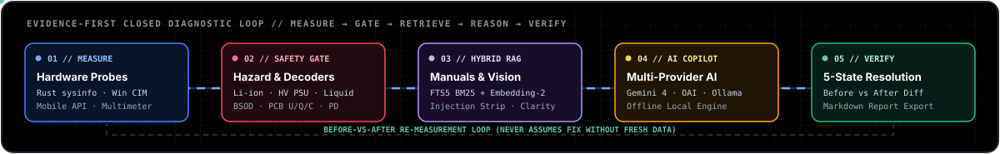
</div>

<br/>

### Colorful AI Copilot Reasoning, Safety Gate & Provider Routing Pipeline

```mermaid
flowchart LR
    subgraph INPUTS["1. MULTIMODAL EVIDENCE INPUTS"]
        I_TXT["Text / Voice Transcript<br/>Symptom &amp; Multi-Turn Context"]
        I_IMG["Board / Error Photo<br/>Magic-Byte + Image Clarity Gate<br/>(Flags under 400x300px or 8 KB)"]
        I_SNAP["Diagnostic Snapshots<br/>measured | simulated | unavailable"]
    end

    SAFETY{"2. HARDWARE SAFETY GATE<br/>evaluateHardwareSafety()"}

    BLOCK["CRITICAL STOP / HIGH RISK<br/>Swollen Li-ion · HV PSU/Fuse · Live Liquid<br/>Blocks Direct DIY · Pro Referral"]

    subgraph ENRICH["3. DETERMINISTIC ENRICHMENT & HYBRID RAG"]
        DEC["Hardware Reference Decoders<br/>7 BSOD/Event IDs · 7 PCB Prefixes<br/>USB-C PD 5V–28V Meter Decoder"]
        RAG_ENG["Hybrid Technical Manuals RAG<br/>SQLite FTS5 BM25 (45%) +<br/>Gemini Embedding-2 Cosine (55%)<br/>Prompt-Injection Redaction"]
        HYP["Evidence & Hypothesis Engine<br/>Multi-Turn Evolution · Zero Fake %<br/>Discriminating Tests"]
    end

    ROUTER{"4. CONSENT-GATED<br/>AI PROVIDER ROUTER"}

    BYOK["User Encrypted BYOK<br/>AES-256-GCM Decrypted<br/>Gemini / OpenAI / Ollama"]
    GEM4["Server Gemini 4<br/>@google/genai Interactions API<br/>Native Tool Declarations + Vision"]
    OAI_S["Server OpenAI<br/>Chat Completions + Vision"]
    LOC["CoreSense Local Engine<br/>Offline-First Deterministic Engine<br/>+ Automatic Cloud Fallback"]

    OUT["5. STRUCTURED COPILOT TURN<br/>Narrative + Evidence + Hypotheses<br/>+ Validated Tool Proposals + Citations<br/>+ Scrubbed AI Cost Ledger Entry"]

    I_TXT --> SAFETY
    I_IMG --> SAFETY
    I_SNAP --> SAFETY

    SAFETY -->|"blockDirect = true"| BLOCK
    SAFETY -->|"Safe or Caution Warning"| DEC
    SAFETY -->|"Safe or Caution Warning"| RAG_ENG
    SAFETY -->|"Safe or Caution Warning"| HYP

    DEC --> ROUTER
    RAG_ENG --> ROUTER
    HYP --> ROUTER

    ROUTER -->|"1st Priority (Consent + BYOK)"| BYOK
    ROUTER -->|"2nd Priority (GEMINI_API_KEY)"| GEM4
    ROUTER -->|"3rd Priority (OPENAI_API_KEY)"| OAI_S
    ROUTER -->|"Offline / No Key / No Consent"| LOC

    BYOK -.->|"Provider Error Fallback"| LOC
    GEM4 -.->|"Provider Error Fallback"| LOC
    OAI_S -.->|"Provider Error Fallback"| LOC

    BYOK --> OUT
    GEM4 --> OUT
    OAI_S --> OUT
    LOC --> OUT
    BLOCK --> OUT

    classDef inp fill:#1e3a8a,stroke:#60a5fa,stroke-width:2px,color:#ffffff
    classDef gate fill:#92400e,stroke:#fbbf24,stroke-width:2.5px,color:#ffffff
    classDef block fill:#9f1239,stroke:#fb7185,stroke-width:2.5px,color:#ffffff
    classDef enrich fill:#155e75,stroke:#22d3ee,stroke-width:2px,color:#ffffff
    classDef router fill:#4c1d95,stroke:#c084fc,stroke-width:2.5px,color:#ffffff
    classDef cloud fill:#312e81,stroke:#818cf8,stroke-width:2px,color:#ffffff
    classDef local fill:#065f46,stroke:#34d399,stroke-width:2px,color:#ffffff
    classDef out fill:#0f766e,stroke:#5eead4,stroke-width:2.5px,color:#ffffff

    class I_TXT,I_IMG,I_SNAP inp
    class SAFETY gate
    class BLOCK block
    class DEC,RAG_ENG,HYP enrich
    class ROUTER router
    class BYOK,GEM4,OAI_S cloud
    class LOC local
    class OUT out

    style INPUTS fill:#0c1930,stroke:#3b82f6,stroke-width:1.5px,color:#bfdbfe
    style ENRICH fill:#08222e,stroke:#06b6d4,stroke-width:1.5px,color:#cffafe
```

### Multi-Provider AI Router & Cost Ledger Rates

CoreSense routes requests in strict priority order when `externalAiConsent === true`:
**`1. User Encrypted BYOK`** → **`2. Server Gemini 4`** → **`3. Server OpenAI`** → **`4. CoreSense Local Diagnostic Engine`**.
If any cloud provider returns an error or times out, CoreSense transparently falls back to `coresense-local-fallback` without interrupting the active investigation.

| Provider | Model Identifier | API Protocol | Vision | Native Tool Calls | Ledger Est. Input / Output (per 1M tokens) |
| :--- | :--- | :--- | :---: | :---: | :--- |
| **Google Gemini** | `gemini-4-hydrogen` *(default)* | `@google/genai` Interactions API | Yes | Yes | \$0.35 / \$1.05 |
| **Google Gemini** | `gemini-4-argon` | `@google/genai` Interactions API | Yes | Yes | \$0.75 / \$2.25 |
| **Google Gemini** | `gemini-4-neon` | `@google/genai` Interactions API | Yes | Yes | \$1.25 / \$5.00 |
| **Google Gemini** | `gemini-embedding-2` | `ai.models.embedContent` | — | — | \$0.025 (RAG embeddings) |
| **OpenAI** | `gpt-4o-mini` *(default)* / `gpt-4o` | `/v1/chat/completions` | Yes | Prompt-guided | \$0.15 / \$0.60 (`4o-mini`) · \$2.50 / \$10.00 (`4o`) |
| **Ollama (Local)** | `llama3.2` *(or custom BYOK)* | Local OpenAI-compatible (`/v1`) | Model-dep. | Prompt-guided | \$0.00 (Local inference) |
| **CoreSense Local** | `coresense-diagnostic-engine-v1` | Built-in Deterministic Engine | Clarity gate | Yes | \$0.00 (100% Offline) |

### Verified Hardware & Electronics Technical Reference Engine (`packages/shared/src/hardwareRef.ts`)

Even completely offline, CoreSense deterministically decodes hardware fault signatures without ever hallucinating schematic values or part numbers:

<details>
<summary><strong>Decoded Windows BSOD Stop Codes &amp; Event IDs (7 Built-in Signatures)</strong></summary>

| Stop / Event Code | Aliases Matched | Subsystem | Primary Diagnostic Focus |
| :--- | :--- | :--- | :--- |
| **`0x00000124`** | `0x124`, `whea_uncorrectable_error`, `whea` | `hardware_cpu_bus` | Machine Check Exception (MCE) / PCIe AER fatal error — check WHEA-Logger Event ID 1/17/18/19, stock BIOS voltages, VRM/CPU thermals, NVMe firmware. |
| **`0x00000116`** | `0x116`, `video_tdr_failure`, `nvlddmkm`, `amdkmdag`, `igdkmd` | `gpu_driver` | GPU Timeout Detection & Recovery (>2s miniport hang) — isolate clean WHQL driver install, GPU hotspot temps, PCIe seating & dedicated power cables. |
| **`0x0000001A`** | `0x1a`, `memory_management` | `memory` | Severe RAM/PTE/pagefile corruption — disable XMP/EXPO to JEDEC base, run 2–4 passes of MemTest86, isolate individual DIMMs. |
| **`0x0000007A`** | `0x7a`, `kernel_data_inpage_error` | `storage` | Kernel page fault from disk (`0xC000009C` bad sectors / `0xC000000E` drive drop) — back up immediately, inspect SMART & Disk Event ID 7/51 / `stornvme` 129. |
| **`0x0000009F`** | `0x9f`, `driver_power_state_failure` | `power_os` | IRP D-state power transition timeout — unplug USB-C/Thunderbolt docks, update chipset/Wi-Fi/GPU drivers, test disabling Fast Startup. |
| **`0x00000133`** | `0x133`, `dpc_watchdog_violation` | `driver_kernel` | Deferred Procedure Call stall — update NVMe SSD firmware, Realtek/Intel NIC drivers, audit recent kernel utilities. |
| **`EVENT_ID_41`** | `event id 41`, `kernel-power 41`, `event 41` | `power_os` | Unexpected reboot marker — distinguish `BugcheckCode=0` (abrupt power cut, PSU OCP/UVP, PROCHOT thermal cutoff) vs non-zero (preceding BSOD). |

</details>

<details>
<summary><strong>Decoded PCB Silkscreen Component Designators (7 Prefixes + Power-Rail <code>P*</code> Variants) &amp; USB-C PD Decoder</strong></summary>

Regex `\b(P?[UQLCFDR])(\d{1,4})\b` automatically matches references such as `U12`, `Q301`, `C402`, `PC14`, `PL5`, `F1`, `D203`, `R104`:

| Prefix | Component Class | Role | Common Failure Modes | Safe Bench Verification Method |
| :---: | :--- | :--- | :--- | :--- |
| **`U` / `PU`** | Integrated Circuit (IC / PMIC / EC / USB-PD / BIOS) | Active logic, regulation, charging control, firmware | Thermal cratering, pin corrosion, rail-to-GND short, cracked BGA | Check pin-1 orientation, read silkscreen under magnification, measure adjacent decoupling caps to GND. |
| **`Q` / `PQ`** | Transistor / Power MOSFET | Buck high/low-side switching, reverse-current gate | Gate-Source or Drain-Source dead short (trips PSU OCP) | Unpowered Drain-Source & Gate-Source resistance/diode drop check. |
| **`C` / `PC`** | Capacitor (MLCC / Polymer / Electrolytic / Tantalum) | Ripple filtering, decoupling, DC blocking | MLCC flex cracking (dead short to GND); bulging electrolytic / high ESR | Visual crack/bulge check; in-circuit continuity across rail caps (isolate parallel rail). |
| **`L` / `PL`** | Inductor / Power Choke | DC-DC buck/boost magnetic energy storage | Cracked ferrite core, open winding, downstream short | Continuity across coil (`<1 Ω`); pad-to-GND impedance (lift one pad to isolate source vs load). |
| **`F` / `PF`** | Fuse / Resettable PTC Polyfuse | Sacrificial over-current protection | Open circuit — almost **always** a symptom of a downstream short | Continuity check. **NEVER bridge a blown fuse** — clear downstream short first. |
| **`D` / `PD`** | Diode / Schottky / TVS ESD Protection | One-way current flow / surge clamping | TVS fails intentionally shorted during surge or wrong-charger event | Diode mode both polarities (~0.2–0.7V fwd, OL rev; `0.000V` both ways = shorted). |
| **`R` / `PR`** | Resistor / Current-Sense Shunt | Current limiting, feedback divider, rail current sense | Open circuit or high resistance drift from overcurrent/corrosion | Visual burn/corrosion inspection + resistance verification against schematic. |

**USB-C Power Delivery (PD) Inline Meter Decoder**: Parses readings such as `5V 0.00A`, `5V 0.04A`, `9V`, `12V`, `15V`, `20V`, `28V`. When stuck at `5V @ <= 0.1A`, CoreSense flags a **USB-C PD Negotiation Failure** (CC1/CC2 line, port pin, EC latch, or PD controller IC like CD3217/TPS6598x) and prescribes a 180° plug-flip test to isolate CC1 vs CC2 before hardware rework.

</details>

### Hybrid Technical Manuals RAG (`apps/api/src/services/rag.ts`)

1. **Multi-Format Per-Page Ingestion**: Supports PDF (`pdf-parse` with custom `pagerender` hook preserving exact page numbers, plus latin1 fallback for non-standard xrefs) and plain-text technical documents (`.md`, `.txt`, `.json`, `.csv`, `.log`, `.yaml` with `\f` or `--- Page N ---` pagination).
2. **Structure-Aware Chunking**: Splits at ~1,100-character paragraph boundaries while detecting section headings (`# Markdown`, numbered `1.2 Section`, `ALL CAPS`), flagging `hasTable` and `hasCommandBlock` metadata per chunk.
3. **Hybrid Retrieval & Reranking**:
   - Primary lexical pass via **SQLite FTS5** with BM25 scoring (`1 / (1 + |bm25_rank|)`).
   - When `GEMINI_API_KEY` is configured, embeds up to the first 20 chunks per upload with **`gemini-embedding-2`** and blends scores: `0.45 × BM25 + 0.55 × CosineSimilarity`.
4. **Prompt-Injection Isolation**: Every retrieved manual excerpt passes through `sanitizeUntrustedDocumentExcerpt()` before reaching the LLM, neutralizing adversarial directives (e.g., `"Ignore all previous instructions..."`) with `[REDACTED_UNTRUSTED_DIRECTIVE]` and flagging `flaggedInjectionAttempt: true`.

### 5-State Before-vs-After Resolution Verification Engine

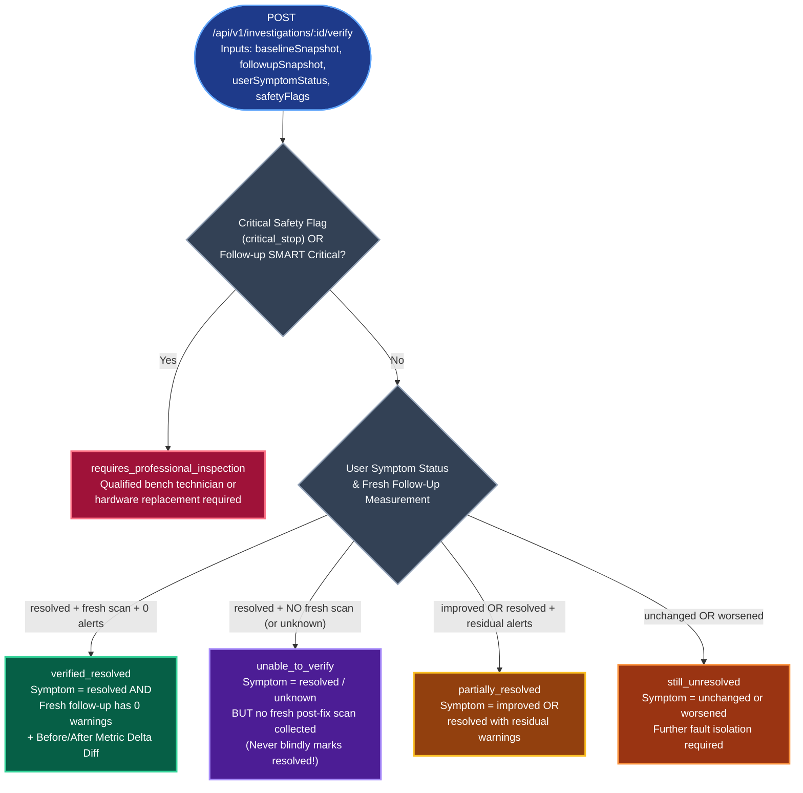

<div align="center">
  
</div>

---

## 5. Validated Diagnostic Tool Registry, Collectors & Simulations

### Colorful Diagnostic Tool Execution & Approval Sequence

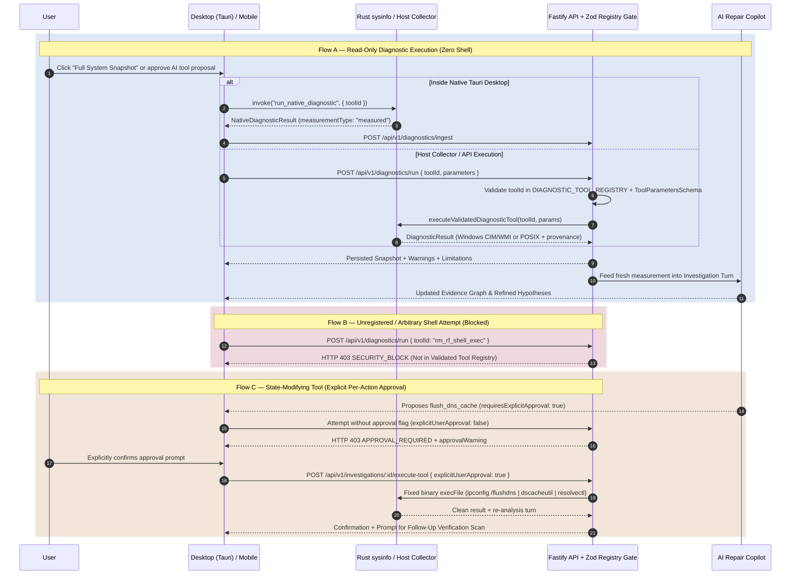

### Complete 9-Tool Validated Diagnostic Registry (`packages/shared/src/tools.ts`)

All tool parameters are strictly validated by `ToolParametersSchema.strict()` (`topProcessCount: 1..20`, `maxEvents: 1..25`, `testHost: /^[a-zA-Z0-9.-]{1,120}$/`), rejecting any unexpected keys or shell metacharacters.

| Tool ID | Display Name | Risk Class | Explicit Approval | Platforms | Collector Implementation & Threshold Warnings |
| :--- | :--- | :--- | :---: | :--- | :--- |
| `cpu_diagnostics` | CPU & Process Profiler | `read_only` | No | Win · macOS · Linux | 250ms tick sampling via `os.cpus()` / Rust `sysinfo`, Windows `Win32_Processor` + `MSAcpi_ThermalZoneTemperature` / `ps`. Warns: `HIGH_CPU_LOAD` (`>=85%`), `ELEVATED_CPU_LOAD` (`>=65%`), `HIGH_CPU_TEMP` (`>=88°C`). |
| `memory_diagnostics` | Memory & Pressure Inspector | `read_only` | No | Win · macOS · Linux | Total/used/available RAM, Windows `Win32_PageFileUsage`, top RAM processes. Pressure levels: `normal` / `elevated` (`>=70%`) / `high` (`>=80%`) / `critical` (`>=90%`). |
| `storage_diagnostics` | Storage & SMART Health Analyzer | `read_only` | No | Win · macOS · Linux | `Win32_LogicalDisk`, `Get-PhysicalDisk` + `Get-StorageReliabilityCounter` (NVMe/SSD wear % & temp), POSIX `df -Pk`. Warns: `LOW_DISK_SPACE` (`>=92%` or `<10 GB`), `SMART_HEALTH_WARNING`, `SSD_HIGH_WEAR` (`>=85%`). |
| `network_diagnostics` | Network, Wi-Fi & DNS Probe | `read_only` | No | Win · macOS · Linux | External interfaces, Windows `Get-NetRoute` / `Get-DnsClientServerAddress` / `netsh wlan show interfaces`, DNS A-record latency + direct TCP `1.1.1.1:443` probe (separates DNS faults from physical link failures!). |
| `os_health_diagnostics` | OS Health, Event Logs & Startup | `read_only` | No | Win · macOS · Linux | OS build, BIOS version, uptime, startup count, Windows `Get-WinEvent` (Application & System Critical/Error logs). Warns: `CRITICAL_OS_EVENTS` (Event ID 41 / Critical), `LONG_UPTIME` (`>240h`). |
| `power_and_peripherals` | Battery, Thermal & Peripheral | `read_only` | No | Win · macOS · Linux | `Win32_Battery` + WMI `BatteryStaticData` / `BatteryFullChargedCapacity` / `BatteryCycleCount`, display adapters (`Win32_VideoController`), audio devices (`Win32_SoundDevice`). Warns: `BATTERY_DEGRADATION` (`>=30%` wear). |
| `full_system_snapshot` | Full System Diagnostic Snapshot | `read_only` | No | Win · macOS · Linux | Parallel `Promise.all` composite run across all 6 host collectors with aggregated warnings & deduplicated platform limitations. |
| `mobile_device_check` | Mobile Permitted Health Check | `user_guided` | No | iOS · Android · Web | Battery state, network reachability & API latency, plus interactive speaker, microphone FFT, display, 16-tile touch, camera, and accelerometer tests ingested via `/api/v1/diagnostics/ingest`. |
| `flush_dns_cache` | Flush Local DNS Resolver Cache | `system_modifying` | **YES** | Win · macOS · Linux | Executes fixed OS binary via `execFile` (no shell): `ipconfig /flushdns` (Windows), `dscacheutil -flushcache` (macOS), `resolvectl flush-caches` (Linux). |

### 11 Deterministic Simulation Fixtures (`packages/diagnostics-core/src/simulations.ts`)

Every simulation fixture is strictly stamped `measurementType: "simulated"`, carries a `simulatedScenarioId`, prefixes its summary with `[SIMULATED]`, and attaches a mandatory limitation banner so it can **never** be mistaken for live hardware:

| Scenario ID | Tool Emulated | Simulated Fault Condition |
| :--- | :--- | :--- |
| `high_cpu_runaway` | `cpu_diagnostics` | Intel Core i7-1260P pinned at `96.4%` CPU (`SearchIndexer.exe`, `84°C`) |
| `high_ram_pressure` | `memory_diagnostics` | `15.3 / 16.0 GB` RAM (`95.6%`, critical pressure, `7,400 MB` pagefile thrash) |
| `low_disk_space` | `storage_diagnostics` | System volume `C:` at `98.2%` full (`4.3 GB` free of `238 GB`) |
| `smart_ssd_failing` | `storage_diagnostics` | Crucial P3 NVMe `96%` wear, `69°C`, `Predictive Failure` SMART warning |
| `wifi_disabled_or_down` | `network_diagnostics` | Zero active external interfaces, Wi-Fi `disconnected`, `ENOTFOUND` |
| `dns_failure_ip_ok` | `network_diagnostics` | Direct TCP `1.1.1.1` OK (`19ms`), DNS lookup `ETIMEOUT` → proposes `flush_dns_cache` |
| `battery_degraded` | `power_and_peripherals` | `54%` capacity wear (`26,200` vs `57,000 mWh` design, `890` cycles) |
| `thermal_overheating` | `cpu_diagnostics` | AMD Ryzen 7 6800U at `97.5°C` under only `38.2%` load (cooling assembly fault) |
| `app_crash_loop` | `os_health_diagnostics` | Repeated Application Error Event ID `1000` (`nvoglv64.dll` `0xc0000005`) + Display `4101` |
| `windows_kernel_power_bsod` | `os_health_diagnostics` | Critical Kernel-Power Event ID `41` + WER BugCheck `1001` (`0x00000124 WHEA`) |
| `healthy_baseline_after_fix` | `full_system_snapshot` | Clean post-remediation state (`CPU 14.2%`, `RAM 44.0%`, `52°C`, `DNS 14ms`, `0 warnings`) |

<div align="center">
  
</div>

---

## 6. Security, Privacy Isolation & Hardware Safety

<div align="center">
  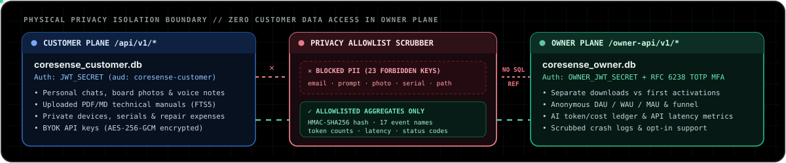
</div>

### Hard Physical Privacy Boundary

1. **Structural Code-Level Isolation**: In [`apps/api/src/routes/ownerRoutes.ts`](apps/api/src/routes/ownerRoutes.ts), `registerOwnerRoutes(app, { ownerDb, config })` **never imports or receives `customerDb`**. Even in the event of a compromised owner session, browsing customer chats, board photos, manuals, or devices is architecturally impossible.
2. **Production PostgreSQL Dual-Schema RBAC**: [`apps/api/migrations/postgres-production.sql`](apps/api/migrations/postgres-production.sql) mirrors this boundary using separate `customer_workspace` and `owner_observability` schemas with `REVOKE ALL ON SCHEMA customer_workspace FROM coresense_owner_role`.
3. **Strict Privacy Allowlist Scrubber (`packages/shared/src/telemetry.ts`)**:
   - **17 Allowlisted Event Names Only**: `app_launched`, `onboarding_completed`, `device_added`, `investigation_started`, `investigation_message_sent`, `investigation_completed`, `diagnostic_scan_run`, `image_analysis_requested`, `document_uploaded`, `voice_interaction_used`, `repair_case_created`, `diagnostic_report_exported`, `sync_completed`, `sync_failed`, `account_registered`, `account_deleted`, `feedback_submitted`.
   - **23 Forbidden Metadata Keys Stripped**: `email`, `name`, `username`, `password`, `token`, `secret`, `prompt`, `message`, `content`, `response`, `image`, `photo`, `document`, `filename`, `filepath`, `path`, `notes`, `serial`, `ip`, `address`, `phone`, `apikey`, `api_key` (plus substring blocks on `email`, `prompt`, `secret`, `token`, `password`, `content`).
   - **Regex PII Redaction**: Strips email addresses (`[REDACTED_EMAIL]`), API credentials/Bearer tokens (`[REDACTED_CREDENTIAL]`), and Windows/macOS/Linux home directory usernames (`C:\Users\[REDACTED]`, `/Users/[REDACTED]`, `/home/[REDACTED]`).
   - **One-Way Anonymous Retention Hashing**: Computes `HMAC-SHA256("anon-telemetry:" + salt, userId)` truncated to 32 hex chars so DAU/WAU/MAU retention works without exposing customer identity.

### Cryptographic & Upload Hardening (`apps/api/src/security/crypto.ts`)

| Security Layer | Implementation Detail |
| :--- | :--- |
| **Password Hashing** | `crypto.scryptSync` (64-byte derived key + 16-byte random hex salt per user, format `scrypt$<salt>$<hash>`) verified with `crypto.timingSafeEqual`. |
| **BYOK Secret Encryption** | **AES-256-GCM** authenticated encryption at rest (`v1:<12-byte-iv>:<authTag>:<ciphertext>`) using SHA-256 derived `ENCRYPTION_KEY`. Plaintext API keys are never persisted. |
| **Dual-Secret HS256 JWT** | Zero-dependency HMAC-SHA256 JWT verification with constant-time signature checks and strict audience enforcement (`coresense-customer` w/ `JWT_SECRET` 7d TTL vs `coresense-owner` w/ `OWNER_JWT_SECRET` 12h TTL). |
| **Owner TOTP MFA** | Standards-compliant **RFC 6238 TOTP** (20-byte Base32 secret, 6-digit 30-second window with `±1` step clock-skew tolerance, `otpauth://` provisioning URI). |
| **Magic-Byte Upload Guard** | Enforces 20 MB cap, explicitly blocks Windows PE (`MZ`) & Linux `ELF` executables, validates real signatures (`%PDF-`, PNG, JPEG, WebP, WAV/WebM/MP3), and rejects NUL bytes masquerading as text manuals. |
| **API Abuse Protection** | `@fastify/rate-limit` (`300 req/min`), 24 MB body cap, strict Zod schema validation on every endpoint, and a global error handler that never leaks stack traces to clients. |

### Hardware Repair Safety Policy (`packages/shared/src/safety.ts`)

| Hazard Rule Code | Severity | Blocks DIY Steps? | Trigger Examples & Intervention |
| :--- | :---: | :---: | :--- |
| `SWOLLEN_OR_DAMAGED_LITHIUM_BATTERY` | **CRITICAL** (`critical_stop`) | **YES** | Swollen, bulging, punctured, hissing, smoking, or poking Li-ion/LiPo cells → Immediate STOP, no charging/heat/prying, ventilated isolation, certified recycler/shop referral. |
| `HIGH_VOLTAGE_PSU_CAPACITOR` | **CRITICAL** (`critical_stop`) | **YES** | Opening desktop ATX/SMPS PSUs (320–400V DC bus), CRTs, microwaves, probing mains, or bypassing fuses with wire/foil → Lethal stored energy warning + licensed technician referral. |
| `LIVE_LIQUID_DAMAGE` | **HIGH RISK** (`high_risk`) | **YES** | Powering on, charging, or hair-dryer/rice/oven drying spilled/wet devices → Immediate unplug/disconnect battery, 99% IPA/ultrasonic inspection before re-energizing. |
| `BOARD_LEVEL_SOLDERING_REWORK` | **CAUTION** (`caution`) | No (Injects Warning) | Micro-soldering, BGA reflow/reball, hot-air MOSFET/IC replacement → ESD grounding, fume extraction, Kapton shielding, rail impedance checks, no household ovens/heat guns. |

<div align="center">
  
</div>

---

## 7. Dual-Database Schema Reference

CoreSense uses **Node 24's built-in `node:sqlite` (`DatabaseSync`)** in **WAL journal mode** with foreign keys enabled locally/in containers, and ships a matching dual-schema **PostgreSQL** production migration in [`apps/api/migrations/postgres-production.sql`](apps/api/migrations/postgres-production.sql).

### Database 1: Private Customer Workspace (`coresense_customer.db` — 15 Tables + FTS5)

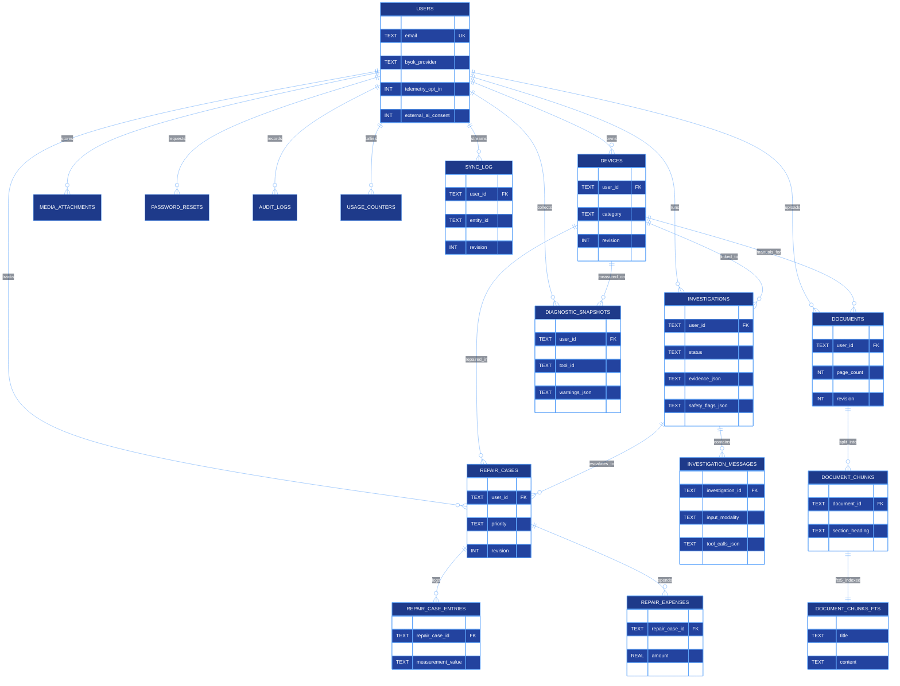

### Database 2: Isolated Owner Observability (`coresense_owner.db` — 14 Aggregate Tables)

```mermaid
%%{init: {"theme": "base", "themeVariables": { "primaryColor": "#065f46", "primaryTextColor": "#ffffff", "primaryBorderColor": "#34d399", "lineColor": "#34d399", "textColor": "#f8fafc", "edgeLabelBackground": "#071c16", "secondaryColor": "#062119", "tertiaryColor": "#0f2922", "attributeBackgroundColorOdd": "#071c16", "attributeBackgroundColorEven": "#0c2b22" }}}%%
erDiagram
    APP_ACTIVATIONS ||--o{ PRODUCT_EVENTS : "emits_anon_install"
    APP_ACTIVATIONS ||--o{ CRASH_REPORTS : "reports_scrubbed"
    ACCOUNT_LIFECYCLE ||--o{ PRODUCT_EVENTS : "tracks_anon_hash"
    ACCOUNT_LIFECYCLE ||--o{ AI_USAGE_LEDGER : "attributes_cost"

    OWNER_ADMINS {
        TEXT id PK
        TEXT email UK
        TEXT password_hash
        TEXT totp_secret
        INT totp_enabled
    }
    INSTALLER_DOWNLOADS {
        TEXT id PK
        TEXT platform
        TEXT channel
        TEXT app_version
        TEXT architecture
    }
    APP_ACTIVATIONS {
        TEXT install_id PK
        TEXT platform
        TEXT app_version
        TEXT first_activated_at
        TEXT last_seen_at
    }
    ACCOUNT_LIFECYCLE {
        TEXT anonymous_user_hash PK
        TEXT platform
        TEXT registered_at
        TEXT deleted_at
        TEXT last_active_at
    }
    PRODUCT_EVENTS {
        TEXT id PK
        TEXT event_name
        TEXT anonymous_install_id
        TEXT anonymous_user_hash
        INT duration_ms
        INT success
    }
    AI_USAGE_LEDGER {
        TEXT id PK
        TEXT provider
        TEXT model
        TEXT feature
        INT input_tokens
        INT output_tokens
        REAL estimated_cost_usd
    }
    CRASH_REPORTS {
        TEXT id PK
        TEXT platform
        TEXT component
        TEXT error_name
        TEXT scrubbed_message
    }
    API_METRICS {
        INT id PK
        TEXT method
        TEXT route_pattern
        INT status_code
        INT latency_ms
    }
    USER_FEEDBACK {
        TEXT id PK
        TEXT category
        INT rating
        TEXT status
    }
    OPT_IN_SUPPORT_REPORTS {
        TEXT id PK
        INT consent_confirmed
        TEXT consent_timestamp
        TEXT attached_diagnostics_json
    }
    ALERT_RULES {
        TEXT id PK
        TEXT metric_key UK
        REAL threshold_value
        TEXT unit
        INT enabled
    }
    PRODUCT_CONFIG {
        TEXT key PK
        TEXT value_json
        TEXT updated_at
    }
```

> **Note**: Legacy schema tables `billing_events` and `plan_configs` are retained in `coresense_owner.db` for backward migration compatibility; billing routes are disabled.

<div align="center">
  
</div>

---

## 8. Cross-Device Delta Synchronization Protocol

Desktop and Mobile clients stay seamlessly synchronized across **5 entity types** (`device`, `investigation`, `repair_case`, `document`, `diagnostic_snapshot`) using an append-only monotonic `sync_log` sequence cursor (`sinceSeq`) combined with **optimistic concurrency control (`baseRevision`)** that guarantees stale offline devices never silently overwrite newer edits.

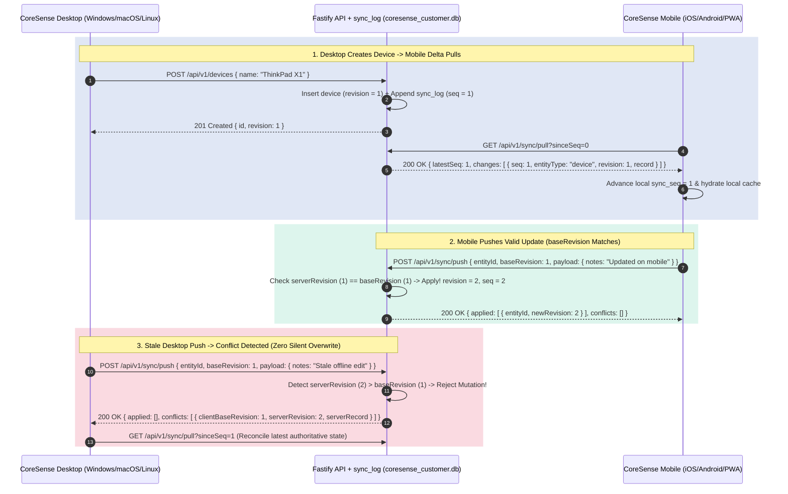

<div align="center">
  
</div>

---

## 9. Complete REST API Reference

Every customer route lives under `/api/v1/*` and enforces `Authorization: Bearer <customer-jwt>` (except public health/release/auth/telemetry endpoints). Every owner route lives under `/owner-api/v1/*` and enforces `Authorization: Bearer <owner-jwt>`.

<details open>
<summary><strong>Customer Workspace Plane (<code>/api/v1/*</code>) — 48 Endpoints</strong></summary>

#### Public Health, Release Manifest & Anonymous Telemetry
| Method | Endpoint | Auth | Description |
| :--- | :--- | :---: | :--- |
| `GET` | `/api/v1/health` | Public | Server liveness, product version, and active integration flags (`geminiConfigured`, `openaiConfigured`, `localDiagnosticEngineActive`). |
| `GET` | `/api/v1/releases/latest` | Public | Latest desktop installer filenames (NSIS/MSI/DMG/AppImage) & mobile package metadata for auto-update checks. |
| `POST` | `/api/v1/downloads/track` | Public | Logs distinct installer download events (`platform`, `channel`, `appVersion`, `architecture`). |
| `POST` | `/api/v1/telemetry/activation` | Public | Idempotently registers first-launch activations (`isFirstActivation`) and updates `last_seen_at`. |
| `POST` | `/api/v1/telemetry/event` | Public | Ingests allowlisted, scrubbed product events (validated by `ProductTelemetryEventSchema`). |
| `POST` | `/api/v1/telemetry/crash` | Public | Ingests PII-scrubbed client crash reports (`component`, `errorName`, scrubbed message/stack). |

#### Authentication, Account Privacy, BYOK & Data Portability
| Method | Endpoint | Auth | Description |
| :--- | :--- | :---: | :--- |
| `POST` | `/api/v1/auth/register` | Public | Creates account (`scrypt` password hash), returns 7-day Customer JWT & serialized profile. |
| `POST` | `/api/v1/auth/login` | Public | Authenticates customer email/password and returns Customer JWT. |
| `POST` | `/api/v1/auth/recover/request` | Public | Generates 6-digit hashed recovery code (15-min TTL; exposes `devRecoveryCode` outside production). |
| `POST` | `/api/v1/auth/recover/confirm` | Public | Verifies recovery code and updates password hash. |
| `GET` | `/api/v1/account/me` | Customer | Returns profile, monthly usage counters, entity counts, and active AI runtime disclosure. |
| `PATCH` | `/api/v1/account/settings` | Customer | Updates display name, privacy/sync/AI consent flags, and AES-256-GCM encrypted BYOK provider settings. |
| `POST` | `/api/v1/account/test-ai` | Customer | Live connection latency & validity test for `gemini`, `openai`, `ollama`, or `coresense-local`. |
| `GET` | `/api/v1/account/export` | Customer | Complete personal data portability export (JSON archive of devices, chats, snapshots, manuals, cases, expenses, audit logs). |
| `DELETE` | `/api/v1/account` | Customer | Permanently deletes customer account, FTS5 chunks, media files on disk, and cascades all private records. |

#### Personal Device Library
| Method | Endpoint | Auth | Description |
| :--- | :--- | :---: | :--- |
| `GET` | `/api/v1/devices` | Customer | Lists user devices (`?includeArchived=true`) with aggregated `caseCount`, `snapshotCount`, and `totalRepairSpend`. |
| `POST` | `/api/v1/devices` | Customer | Creates a device profile (`DeviceCreateSchema`) and logs sync change. |
| `PATCH` | `/api/v1/devices/:id` | Customer | Updates device attributes/archive status and increments monotonic `revision`. |
| `DELETE` | `/api/v1/devices/:id` | Customer | Soft-deletes device (`deleted_at`) and publishes sync tombstone. |

#### Diagnostics, Native Ingestion & Simulations
| Method | Endpoint | Auth | Description |
| :--- | :--- | :---: | :--- |
| `GET` | `/api/v1/diagnostics/tools` | Customer | Returns the complete 9-tool `DIAGNOSTIC_TOOL_REGISTRY` with risk levels and platform matrices. |
| `POST` | `/api/v1/diagnostics/run` | Customer | Executes a validated host diagnostic tool (returns `403` for unregistered tools or unapproved state-modifying tools). |
| `POST` | `/api/v1/diagnostics/ingest` | Customer | Persists a `DiagnosticResult` gathered natively by Desktop Tauri Rust or Mobile Capacitor/PWA. |
| `POST` | `/api/v1/diagnostics/simulate` | Customer | Generates and persists one of the 11 explicitly labeled `measurementType: "simulated"` fixtures. |
| `GET` | `/api/v1/diagnostics/history` | Customer | Retrieves recent diagnostic snapshots (`?deviceId=&limit=30`, max 100). |

#### AI Repair Copilot Investigations
| Method | Endpoint | Auth | Description |
| :--- | :--- | :---: | :--- |
| `GET` | `/api/v1/investigations` | Customer | Lists user investigations with evidence, hypothesis, and safety-flag counts. |
| `POST` | `/api/v1/investigations` | Customer | Starts a new investigation (supports text, voice transcript, base64 board photo, and attached `snapshotIds`). |
| `GET` | `/api/v1/investigations/:id` | Customer | Fetches full investigation state, messages, evidence, hypotheses, pending tools, safety flags, and verification report. |
| `POST` | `/api/v1/investigations/:id/messages` | Customer | Sends a follow-up turn with optional new photo or fresh diagnostic snapshots. |
| `POST` | `/api/v1/investigations/:id/measurements` | Customer | Records a manual instrument reading (e.g., multimeter voltage/resistance, USB-C PD meter) tagged `user_reported`. |
| `POST` | `/api/v1/investigations/:id/execute-tool` | Customer | Executes an approved diagnostic tool inside the investigation and immediately runs a Copilot analysis turn. |
| `POST` | `/api/v1/investigations/:id/verify` | Customer | Runs the 5-outcome before-vs-after Resolution Verification engine against baseline & follow-up snapshots. |
| `GET` | `/api/v1/investigations/:id/report` | Customer | Exports structured JSON + formatted Markdown Diagnostic Investigation Report. |
| `DELETE` | `/api/v1/investigations/:id` | Customer | Soft-deletes investigation and records sync tombstone. |

#### Technical Manuals Knowledge Base (RAG)
| Method | Endpoint | Auth | Description |
| :--- | :--- | :---: | :--- |
| `GET` | `/api/v1/documents` | Customer | Lists indexed technical manuals with page counts, chunk counts, and section summaries. |
| `POST` | `/api/v1/documents` | Customer | Uploads multipart file or JSON (`contentText`/`contentBase64`), validates magic bytes, chunks, indexes FTS5 + optional Gemini embeddings. |
| `GET` | `/api/v1/documents/search?q=` | Customer | Hybrid BM25 + Vector search returning sanitized page-cited excerpts (`flaggedInjectionAttempt` tagged). |
| `DELETE` | `/api/v1/documents/:id` | Customer | Purges FTS5 & chunk records, soft-deletes document, and publishes sync tombstone. |

#### Personal Repair Cases, Sync & Voluntary Feedback
| Method | Endpoint | Auth | Description |
| :--- | :--- | :---: | :--- |
| `GET` / `POST` | `/api/v1/cases` | Customer | Lists or creates repair cases with total expenses & entry counts. |
| `GET` / `PATCH` / `DELETE` | `/api/v1/cases/:id` | Customer | Reads full case + entries + expenses; updates status/notes; soft-deletes case. |
| `POST` | `/api/v1/cases/:id/entries` | Customer | Appends timeline entry (`note`, `measurement`, `photo`, `step`, `finding`). |
| `POST` | `/api/v1/cases/:id/expenses` | Customer | Logs categorized repair cost (`part`, `tool`, `service`, `shipping`, `other`). |
| `GET` | `/api/v1/sync/pull?sinceSeq=` | Customer | Pulls up to 200 delta changes since sequence cursor across all 5 synced entity types. |
| `POST` | `/api/v1/sync/push` | Customer | Pushes up to 50 client mutations with `baseRevision` conflict checking. |
| `POST` | `/api/v1/feedback` | Customer | Submits voluntary user feedback, bug reports, or feature requests. |
| `POST` | `/api/v1/support/opt-in-report` | Customer | Requires `explicitUserConsent: true` to transmit an explicitly chosen support summary to the Owner Console. |

</details>

<details>
<summary><strong>Isolated Owner Observability Plane (<code>/owner-api/v1/*</code>) — 14 Endpoints (Zero Customer DB Access)</strong></summary>

| Method | Endpoint | Auth | Description |
| :--- | :--- | :---: | :--- |
| `POST` | `/owner-api/v1/auth/login` | Public | Owner admin login (enforces `totpCode` when MFA enabled); issues 12-hour `coresense-owner` JWT. |
| `GET` | `/owner-api/v1/auth/me` | Owner | Returns owner profile and architectural privacy isolation attestation. |
| `POST` | `/owner-api/v1/auth/mfa/setup` | Owner | Generates new RFC 6238 Base32 TOTP secret & `otpauth://` provisioning URI. |
| `POST` | `/owner-api/v1/auth/mfa/enable` | Owner | Validates 6-digit TOTP code and enforces MFA on subsequent logins. |
| `GET` | `/owner-api/v1/overview?range=` | Owner | Executive KPIs (downloads, activations, DAU/WAU/MAU, AI spend, API error rate, crash-free %) + evaluated alert rules. |
| `GET` | `/owner-api/v1/downloads?range=` | Owner | Strictly separated installer downloads, first activations, active version counts, and aggregate country totals. |
| `GET` | `/owner-api/v1/users?range=` | Owner | Daily signups, daily active users, platform adoption, retention %, and account deletion churn rate. |
| `GET` | `/owner-api/v1/engagement?range=` | Owner | Per-event frequency, unique users, and 7-stage diagnostic funnel conversion counts. |
| `GET` | `/owner-api/v1/ai-costs?range=` | Owner | Aggregate AI request counts, input/output tokens, latency, failure counts, and estimated USD spend. |
| `GET` | `/owner-api/v1/reliability?range=` | Owner | Per-route API latency/4xx/5xx stats, DB size, uptime, operational failures, and scrubbed client crash logs. |
| `GET` | `/owner-api/v1/feedback` | Owner | Average star rating, voluntary feedback inbox, and explicitly consented opt-in support reports. |
| `PATCH` | `/owner-api/v1/feedback/:id` | Owner | Updates feedback triage status (`new`, `reviewed`, `planned`, `resolved`, `dismissed`). |
| `GET` / `PATCH` | `/owner-api/v1/config` · `/config/alerts/:id` | Owner | Reads product config & updates live alert threshold values and enabled toggles. |

</details>

<div align="center">
  
</div>

---

## 10. Getting Started & Local Development

### Prerequisites

- **Node.js `24+`** (required for built-in `node:sqlite` `DatabaseSync` with FTS5) & **npm `10+`**
- *(Optional, for native Desktop builds)* **Rust toolchain** (`rustup` / `cargo`) + Tauri v2 OS prerequisites (WebView2 on Windows, Xcode CLT on macOS, `libwebkit2gtk-4.1-dev` on Ubuntu/Debian)
- *(Optional, for native Mobile builds)* **Android Studio** (Android `.aab`) or **Xcode on macOS** (iOS `.ipa`)

### Step-by-Step Setup

1. **Clone the repository and configure environment variables:**
   ```bash
   git clone https://github.com/hrdk6/CoreSense.git
   cd CoreSense
   cp .env.example .env
   ```
   > **Zero-Key Offline Start**: You do **not** need any external API keys to run CoreSense. Without `GEMINI_API_KEY` or `OPENAI_API_KEY`, the built-in **CoreSense Local Diagnostic Engine** powers all diagnostics, hardware decoders, safety gates, FTS5 manual RAG, and 5-state verification offline. Add `GEMINI_API_KEY` anytime (or per-user encrypted BYOK in Settings) to unlock live **Gemini 4** multimodal board vision and `gemini-embedding-2` vector RAG.

2. **Install dependencies and build all workspaces:**
   ```bash
   npm install
   npm run build
   ```

3. **Run the complete automated test & AI evaluation suite (23 tests):**
   ```bash
   npm test
   ```

4. **Launch the connected platform applications (in separate terminals):**
   ```bash
   npm run dev:api           # Backend API on http://127.0.0.1:4000
   npm run dev:desktop       # Desktop App UI on http://127.0.0.1:5173
   npm run dev:desktop:tauri # (Optional) Native Rust + Tauri v2 Desktop window
   npm run dev:mobile        # Mobile Companion PWA on http://127.0.0.1:8081
   npm run dev:owner         # Private Owner Console on http://127.0.0.1:5175
   ```

5. **Testing Mobile Companion on a Physical Phone over Local Wi-Fi (LAN Dev):**
   - Start the API with `HOST=0.0.0.0` (`HOST=0.0.0.0 npm run dev:api`) and Vite mobile with `--host` (`npx --workspace @coresense/mobile vite --host --port 8081`).
   - Open `http://<YOUR_LAN_IP>:8081` on your phone. `mobileApi.ts` automatically routes API requests to `http://<YOUR_LAN_IP>:4000`, and `apps/api/src/server.ts` automatically permits private RFC 1918 LAN origins (`192.168.*`, `10.*`, `172.16-31.*`) in non-production mode!

### Default Local Owner Console Credentials

> **Warning:** Always change these via `.env` before deploying to production.

- **URL:** `http://127.0.0.1:5175`
- **Email:** `owner@coresense.app` *(override via `OWNER_INITIAL_EMAIL`)*
- **Password:** `CoreSenseOwner#2026!` *(override via `OWNER_INITIAL_PASSWORD`)*
- **MFA:** Navigate to **Config & MFA** inside the Owner Console to enroll any RFC 6238 authenticator app (Google Authenticator, 1Password, Authy, Bitwarden).

### Root NPM Scripts Reference

| Command | Action |
| :--- | :--- |
| `npm run build` | Builds `@coresense/shared`, `@coresense/diagnostics-core`, `@coresense/api`, `@coresense/desktop`, and `@coresense/owner-console` |
| `npm run typecheck` | Runs strict `tsc --noEmit` across all 5 TypeScript packages/apps |
| `npm test` | Runs all 23 Vitest tests (`tests/ai-eval.test.ts` + `tests/coresense.e2e.test.ts`) |
| `npm run test:watch` | Runs Vitest in interactive watch mode |
| `npm run dev:api` | Starts Fastify API with hot reload (`tsx watch`) on `:4000` |
| `npm run dev:desktop` | Starts Desktop React UI via Vite on `:5173` |
| `npm run dev:desktop:tauri` | Launches the native Tauri v2 + Rust Desktop window |
| `npm run dev:mobile` | Starts Mobile Companion Vite server on `:8081` |
| `npm run dev:owner` | Starts isolated Private Owner Console on `:5175` |
| `npm run build:desktop:installer` | Compiles production native desktop binary & NSIS/MSI installer via Tauri v2 |

<div align="center">
  
</div>

---

## 11. Environment Configuration Reference

Copy [`.env.example`](.env.example) to `.env` in the repository root or `apps/api/.env`.

<details>
<summary><strong>Click to expand Full Environment Variable Matrix (23 Variables)</strong></summary>

| Variable | Default Value | Prod Required | Purpose & Unset Behavior |
| :--- | :--- | :---: | :--- |
| `NODE_ENV` | `development` | Yes | Set `production` to disable `devRecoveryCode` responses & private-LAN wildcard CORS. |
| `HOST` | `127.0.0.1` | Yes | Bind address (`0.0.0.0` in Docker/cloud or LAN mobile dev). |
| `PORT` | `4000` | Optional | Fastify HTTP listening port. |
| `CORS_ORIGINS` | Localhost + Tauri origins | Yes | Comma-separated allowed browser/WebView origins. |
| `JWT_SECRET` | Dev placeholder | **CRITICAL** | 64-byte random secret signing `coresense-customer` JWTs & anonymous user HMAC hashes. |
| `OWNER_JWT_SECRET` | Dev placeholder | **CRITICAL** | Completely separate 64-byte random secret signing `coresense-owner` JWTs. |
| `ENCRYPTION_KEY` | Dev placeholder | **CRITICAL** | 32+ byte secret key used for AES-256-GCM encryption of user BYOK provider keys. |
| `DATA_DIR` | `./apps/api/data` | Yes | Persistent disk directory storing `coresense_customer.db`, `coresense_owner.db`, and `uploads/`. |
| `CUSTOMER_DATABASE_URL` | *(unset)* | Optional | PostgreSQL connection string for `customer_workspace` schema (see `migrations/postgres-production.sql`). |
| `OWNER_DATABASE_URL` | *(unset)* | Optional | Separate PostgreSQL connection string for `owner_observability` schema. |
| `OWNER_INITIAL_EMAIL` | `owner@coresense.app` | Yes | Bootstrapped Owner Console admin email on first empty-DB startup. |
| `OWNER_INITIAL_PASSWORD` | `CoreSenseOwner#2026!` | **CRITICAL** | Bootstrapped Owner Console password (hashed with `scrypt` on first startup). |
| `GEMINI_API_KEY` *(or `GOOGLE_API_KEY`)* | *(unset)* | Optional | Enables live **Gemini 4 Interactions API** reasoning, board photo vision, and `gemini-embedding-2` RAG. Falls back cleanly to Local Diagnostic Engine when unset. |
| `GEMINI_MODEL` | `gemini-4-hydrogen` | Optional | Default Gemini text/tool-calling model (`gemini-4-hydrogen`, `gemini-4-argon`, `gemini-4-neon`). |
| `GEMINI_VISION_MODEL` | `gemini-4-hydrogen` | Optional | Gemini multimodal vision model for board/component photographs. |
| `GEMINI_EMBEDDING_MODEL` | `gemini-embedding-2` | Optional | Gemini embedding model for hybrid RAG cosine reranking. |
| `OPENAI_API_KEY` | *(unset)* | Optional | Enables server-wide OpenAI or compatible endpoint fallback. |
| `OPENAI_BASE_URL` | `https://api.openai.com/v1` | Optional | Override for OpenAI-compatible gateways or local Ollama (`http://127.0.0.1:11434/v1`). |
| `OPENAI_MODEL` | `gpt-4o-mini` | Optional | Default OpenAI chat/vision model. |
| `PUBLIC_API_URL` | `http://127.0.0.1:4000` | Optional | External API base URL used for manifest links & references. |
| `DESKTOP_APP_URL` | `http://localhost:5173` | Optional | Desktop frontend URL. |
| `OWNER_CONSOLE_URL` | `http://localhost:5175` | Optional | Standalone Owner Console URL. |
| `VITE_API_URL` *(Frontend build-time)* | Auto (`:4000`) | Cloud Static | Default backend endpoint baked into Desktop, Mobile PWA, and Owner Console builds. |

</details>

<div align="center">
  
</div>

---

## 12. Testing & 18-Scenario AI Diagnostic Evaluation Suite

CoreSense verifies platform security, privacy isolation, sync integrity, real OS collectors, and AI diagnostic rigor automatically via **Vitest** using isolated in-memory dual SQLite instances (`23/23 passing`).

```bash
npm test          # Execute all 23 automated E2E + AI diagnostic evaluation tests
npm run typecheck # Strict TypeScript verification across all 5 workspaces
```

| Test Suite | Tests | Verified Guarantees |
| :--- | :---: | :--- |
| **[`tests/ai-eval.test.ts`](tests/ai-eval.test.ts)** | **16 tests** *(Scenarios 1–18)* | • **Scenarios 1–8**: High CPU (`SearchIndexer`), Critical RAM (`95.6%`), Low Disk (`98.2%`), Predictive SMART SSD Failure (backup + pro referral), Wi-Fi Down, DNS Failure w/ IP OK (proposes approval-gated `flush_dns_cache`), Battery Wear (`54%`), Thermal Overheating (`97.5°C`)<br/>• **Scenario 9**: USB-C charging cable/port/PD isolation<br/>• **Scenarios 10 & 11**: App Crash Loop (`Event 1000` / `nvoglv64.dll`) & Windows Kernel-Power `41` / WHEA `0x124`<br/>• **Scenario 12**: Mobile OS Wi-Fi inspection restriction honesty<br/>• **Scenario 13**: Low-res `1×1` PNG board photo clarity rejection + macro request<br/>• **Scenarios 14 & 15**: Ambiguous motherboard replacement second-opinion & vague symptom intake<br/>• **Scenario 16**: Critical safety hard-blocks on swollen Li-ion puncture & PSU fuse foil bypass<br/>• **Scenario 17**: 5-State Resolution Verification (`unable_to_verify` without fresh scan → `verified_resolved` with before/after diff)<br/>• **Scenario 18**: Combined BSOD `0x00000124` + PCB `Q301`/`F1` + USB-C `5V 0.00A` decoding + multi-turn mobile Wi-Fi hypothesis evolution<br/>• **Global Invariant**: Every AI turn is asserted against `/\b\d{1,3}%\s*confiden/i` to guarantee **zero fabricated confidence percentages**. |
| **[`tests/coresense.e2e.test.ts`](tests/coresense.e2e.test.ts)** | **7 suites** | 1. Distinct installer download vs idempotent first-launch activation tracking<br/>2. Account registration, AES-256-GCM BYOK encryption-at-rest check, 6-digit password recovery, live AI test & release manifest<br/>3. Genuine host CPU & RAM measurement + `403` block on arbitrary shell (`rm_rf_shell_exec`) & unapproved `flush_dns_cache`<br/>4. Cross-account workspace isolation (User B cannot view or delete User A's devices)<br/>5. Windows PE binary (`MZ`) upload rejection + multi-page manual indexing + prompt-injection `[REDACTED_UNTRUSTED_DIRECTIVE]` neutralization<br/>6. Desktop-to-Mobile Delta Sync (`sinceSeq` pull, `baseRevision` push, stale push conflict detection)<br/>7. Disabled billing/revenue route verification (`404` assertions), Customer JWT `403` rejection on Owner API, RFC 6238 TOTP MFA enrollment, full Owner API sweep, **hard PII-leak audit across `coresense_owner.db`**, full account JSON export, and permanent cascading deletion. |

<div align="center">
  
</div>

---

## 13. CI/CD, Commercial Packaging & Cloud Deployment

CoreSense includes turnkey CI/CD automation, multi-OS desktop installer packaging, native iOS/Android mobile scaffolding, and production cloud container blueprints.

### Colorful CI/CD & Multi-Platform Distribution Topology

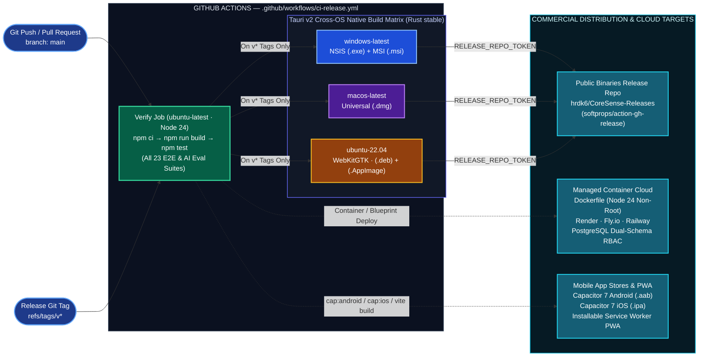

### Deployment Targets Summary

| Target | Configuration File | Key Capabilities |
| :--- | :--- | :--- |
| **Desktop Installers (Win/macOS/Linux)** | [`apps/desktop/src-tauri/tauri.conf.json`](apps/desktop/src-tauri/tauri.conf.json) & [`.github/workflows/ci-release.yml`](.github/workflows/ci-release.yml) | Compiles `com.coresense.desktop` v1.0.0 (`NSIS .exe`, `.msi`, `.dmg`, `.deb`, `.AppImage`) and publishes release binaries to `hrdk6/CoreSense-Releases` on `v*` git tags. Supports EV Authenticode, Apple Gatekeeper notarization, and signed Tauri auto-updates. |
| **Android & iOS Native Apps** | [`apps/mobile/capacitor.config.ts`](apps/mobile/capacitor.config.ts) | Capacitor 7 native bridges (`com.coresense.mobile`) via `cap:android` / `cap:ios` declaring strictly scoped `CAMERA`, `RECORD_AUDIO`, and `ACCESS_NETWORK_STATE` permissions. |
| **Production Docker Image** | [`Dockerfile`](Dockerfile) | Multi-stage `node:24-slim` build, non-root `coresense` user, persistent `/app/data` volume, and built-in 30s `HEALTHCHECK` against `/api/v1/health`. |
| **Render Blueprint** | [`render.yaml`](render.yaml) | One-click provisioning of `coresense-api` (10 GB persistent disk + auto-generated secrets), `coresense-mobile-pwa` static site, and separate `coresense-owner-console` static site. |
| **Fly.io** | [`fly.toml`](fly.toml) | TLS-enforced container (`force_https = true`), persistent `coresense_data` volume at `/app/data`, always-on minimum machine with 30s HTTP health checks. |
| **Railway** | [`railway.toml`](railway.toml) | Dockerfile builder with `/api/v1/health` verification and automatic restart policy (`ON_FAILURE`, max 5 retries). |
| **PostgreSQL Production** | [`apps/api/migrations/postgres-production.sql`](apps/api/migrations/postgres-production.sql) | Dual-schema (`customer_workspace` vs `owner_observability`) RBAC template preserving physical data isolation at scale. |

<div align="center">
  
</div>

---

## 14. Precision Instrument Design System

CoreSense avoids generic AI glassmorphism and decorative gradients in favor of a **gradient-free Precision Bench Instrument UI** engineered for extended diagnostic sessions in both bright workshops and dark labs:

- **Typography Stack**:
  - **Display Headings**: `Archivo` (tight tracking `-0.025em`)
  - **UI Body**: `IBM Plex Sans` (`cv02`, `cv03`, `cv04`, `cv11` stylistic alternates)
  - **Telemetry & Metrics**: `IBM Plex Mono` with strict `font-variant-numeric: tabular-nums` so live CPU %, temperatures, and voltages never jitter horizontally.
- **Dual Precision Themes (Instant Flicker-Free Switching)**:

| Semantic Token | Light Bench Mode | True OLED Black (`#000000`) Dark Mode | Role |
| :--- | :--- | :--- | :--- |
| `--cs-canvas` | `#F8F9FA` | `#000000` *(True OLED Black)* | Primary instrument workspace canvas |
| `--cs-surface` | `#FFFFFF` | `#0A0B0C` | Elevated matte hairline panel |
| `--cs-ink` | `#131820` | `#E8ECEA` *(Soft Pearl — zero OLED halation)* | Primary high-legibility foreground text |
| `--cs-accent` | `#2556B8` | `#7BA7F7` *(Horizon Periwinkle)* | Active probe traces, focus rings, links |
| `--cs-ok` | `#157A66` | `#5EC6A8` *(Sage Mint)* | Verified healthy metrics & `measured` provenance |
| `--cs-warn` | `#A66316` | `#E5B567` *(Honey Sand)* | Cautions, elevated pressure, `simulated` badges |
| `--cs-danger` | `#B82D45` | `#E87A88` *(Signal Rose)* | Critical hardware hazards & SMART alerts |

---

## 15. Additional Documentation

- **[`ARCHITECTURE.md`](ARCHITECTURE.md)** — High-level system topology and core architectural decision records.
- **[`RELEASE.md`](RELEASE.md)** — Commercial desktop code signing, Apple/Google mobile store packaging instructions, and cloud deployment checklist.
- **[`.env.example`](.env.example)** — Annotated template of all backend and integration environment variables.

<div align="center">
  <br/>
  
  <br/>
  <sub><strong>CoreSense v1.0.0</strong> — <em>"Understand what's happening beneath the surface."</em><br/>Built with Precision Diagnostics, Honest Evidence, Physical Privacy Isolation, and Hardware Safety First.</sub>
</div>
